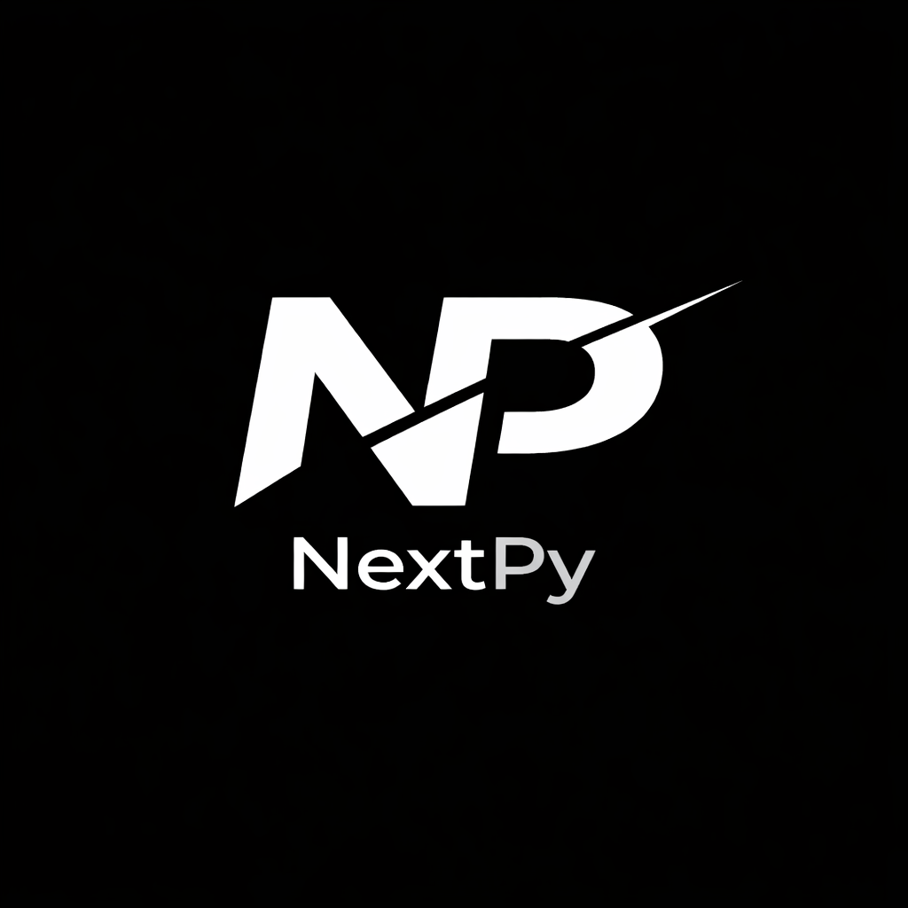

<div align="center">




# NextPy Framework

### The Full-Stack Python Framework


Build modern web applications using Python, PSX, file-based routing, server-side rendering, static generation, React-style hooks, and integrated AI development tools.

[Documentation](https://nextpy.dev) •
[Examples](https://nextpy.dev/examples) •
[Discord](https://discord.gg/nextpy) •
[GitHub Discussions](https://github.com/RahimStudios/nextpy/discussions)

</div


---

## Getting Started

NextPy is a Python-first full-stack framework inspired by the developer experience of Next.js while introducing powerful innovations such as:

* PSX (Python Syntax Extension)
* File-based routing
* Server-side rendering (SSR)
* Static site generation (SSG)
* API routes
* React-style hooks in Python
* Built-in AI coding assistant
* Modern CLI tooling
* Enterprise-ready architecture

### Installation

```bash
pip install nextpy-framework
```

### Create a Project

```bash
nextpy create my-app
cd my-app
nextpy dev
```

Visit:

```text
http://localhost:8000
```

---

## Why NextPy?

### Python First

Build full-stack applications without switching languages.

### PSX

Write component-based user interfaces using NextPy's Python Syntax Extension.


---

## Example psx 

```python
from nextpy.psx import component, useState

@component
def Home(props=None):
    props = props or {}
    [count, setCount] = useState(0)

    def handle_increment(e):
        setCount(count + 1)

    return (
        <div>
            <h1>Welcome to NextPy</h1>

            <button onclick={handle_increment}>
                Count: {count}
            </button>
        </div>
    )

default = Home
```

---

## Sever Side action

```python
# Define a server action
from nextpy.server_actions import server_action

@server_action()
async def create_todo(title: str, session=None):
    todo = Todo(title=title, completed=False)
    session.add(todo)
    session.commit()
    return {"id": todo.id, "title": title}
```

And call it from client PSX:

```python

from nextpy.psx import component
from nextpy.db import Todo, get_session
from nextpy import fetch_api


@component
def TodoPage(props=None):
    props = props or {}
    todos = props.get("todos", [])
    
    return (
        <main data-nextpy-crud="todo" class="min-h-screen px-4 py-12 bg-slate-100 text-slate-900">
            <section class="max-w-2xl p-6 mx-auto bg-white shadow-sm rounded-xl">
                <div class="flex items-center justify-between mb-6">
                    <div>
                        <p class="text-sm font-semibold tracking-wide text-blue-600 uppercase">NextPy</p>
                        <h1 class="text-3xl font-bold">Shared Todos</h1>
                    </div>
                    <span data-nextpy-status class="text-sm text-slate-500">Connecting...</span>
                </div>
                <form data-nextpy-action="create" class="flex gap-2 mb-6">
                    <input data-nextpy-field="title" required maxlength="255" placeholder="What needs doing?" class="flex-1 min-w-0 px-3 py-2 border rounded-lg border-slate-300 focus:border-blue-500 focus:outline-none" />
                    <button type="submit" class="px-4 py-2 font-semibold text-white bg-blue-600 rounded-lg hover:bg-blue-700">Add</button>
                </form>
                <p data-nextpy-error class="hidden p-3 mb-4 text-sm text-red-700 rounded-lg bg-red-50"></p>
                <ul data-nextpy-list class="space-y-2">
                    {for todo in todos:
                        <li data-nextpy-item={todo["id"]} class="flex items-center gap-3 p-3 border rounded-lg border-slate-200">
                            <input data-nextpy-toggle={todo["id"]} type="checkbox" checked={todo["completed"]} aria-label="Complete todo" />
                            <span class={"min-w-0 flex-1 " + ("text-slate-400 line-through" if todo["completed"] else "")}>{todo["title"]}</span>
                            <button data-nextpy-delete={todo["id"]} type="button" class="text-sm font-semibold text-red-600">Delete</button>
                        </li>
                    }
                </ul>
            </section>
        </main>
    )


def getServerSideProps(context):
    with get_session() as db:
        todos = db.query(Todo).order_by(Todo.created_at.desc()).limit(10).all()
        
        return {
            "props": {
                "title": "NextPy Full-Stack Demo",
                "description": "Enhanced client-server communication with server actions and real-time sync",
                "todos": [
                    {
                        "id": todo.id,
                        "title": todo.title,
                        "completed": todo.completed,
                        "created_at": todo.created_at.isoformat() if todo.created_at else None
                    }
                    for todo in todos
                ]
            }
        }


default = TodoPage
```


### Full-Stack by Default

* Frontend with PSX components
* Backend with FastAPI
* Server Actions for client-server communication
* API Routes with automatic routing
* Database Integration with SQLAlchemy
* State Synchronization with WebSocket support
* Authentication & Authorization
* Real-time updates
* Everything in one framework

---

## Full-Stack Capabilities

NextPy v5.0 provides enhanced full-stack features:

- **Server Actions**: Direct client-to-server function calls
- **State Synchronization**: Real-time state management
- **Type-Safe APIs**: Automatic validation and type checking
- **WebSocket Integration**: Built-in real-time updates
- **Database-Backed State**: Persistent state management


[Read the Full-Stack Guide](FULLSTACK_GUIDE.md)


## Documentation

Visit the official documentation:

https://nextpy.dev/docs

Documentation includes:

* Getting Started
* Routing
* PSX
* Components
* Hooks
* Data Fetching
* API Routes
* Deployment
* AI Assistant
* CLI Reference

---

## Community

The NextPy community can be found on GitHub Discussions where you can ask questions, share projects, suggest features, and connect with other developers.

* GitHub Discussions
* Discord Community
* X (Twitter)
* YouTube

Please read and follow our Code of Conduct when participating in community spaces.

---

## Contributing

Contributions are welcome and greatly appreciated.

Before contributing, please read:

* Contribution Guidelines
* Code of Conduct

- Go through this to know exactly what each file does https://github.com/RahimStudios/nextpy-framework/blob/main/.nextpy_framework/nextpy/docs/COMPLETE_FILE_DOCUMENTATION.md 

- Go through this to see all what is implemented fully, partially and what is not, so it can guide you on anywhere to start 
https://github.com/RahimStudios/nextpy-framework/blob/main/.nextpy_framework/nextpy/docs/FRAMEWORK_ANALYSIS.md

Good first issues are available for new contributors looking to get involved.

---

## Security

If you discover a security vulnerability, please do not create a public issue.

Instead, contact:

[security@rahimstudios.com](mailto:security@rahimstudios.com)

We will investigate and respond as quickly as possible.

---

## License

Licensed under the MIT License.

---

<div align="center">

### Built with ❤️ by RahimStudios

The future of AI-native Python development.

</div>
